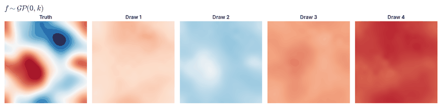
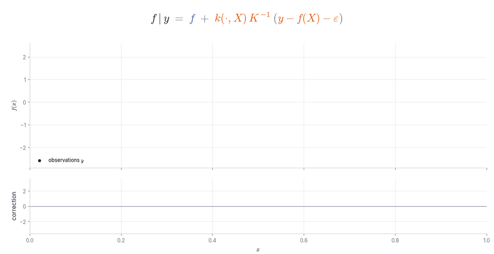
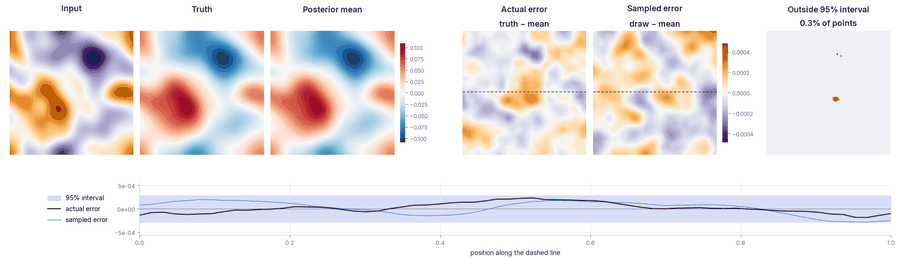

<h1 align="center">Gaussian Process Operator (GPO)</h1>

<p align="center"><b>Towards Gaussian Process for operator learning: an uncertainty aware resolution independent operator
learning algorithm for computational mechanics</b><br>
Sawan Kumar · Rajdip Nayek · Souvik Chakraborty<br>
<i>Computer Methods in Applied Mechanics and Engineering</i>, 2025</p>

<p align="center">
  <a href="https://savnkr.github.io/GPO/"></a>
  <a href="https://doi.org/10.1016/j.cma.2024.117664"></a>
  <a href="https://arxiv.org/abs/2409.10972"></a>
  <a href="https://colab.research.google.com/github/savnkr/GPO/blob/main/notebooks/quickstart.ipynb"></a>
</p>

<p align="center"></p>
<p align="center"><sub>Four prior draws of Navier–Stokes vorticity become exact posterior draws by Matheron's rule.</sub></p>

A **GPO** is a Gaussian process over the solution operator of a PDE, with a kernel built from a neural operator. It
predicts output fields with calibrated uncertainty, accepts inputs at any resolution, and returns **joint posterior
draws of whole fields** through Matheron's rule.

> **Version 2.** This release extends the method of the journal article with an operator-feature term in the kernel,
> exact inference, joint posterior draws by Matheron's rule and stochastic dual descent for large training sets. The
> code accompanying the article remains in the repository history. Full results are on the
> [project page](https://savnkr.github.io/GPO/).

## Highlights

- **Lower error on every benchmark** than the published GPO results.
- **Calibrated uncertainty** that widens where the operator errs, near boundaries and discontinuities.
- **Exact joint draws** by Matheron's rule, tested against a dense Gaussian process.
- **Any input resolution**: trained on one grid, predicts from inputs on other grids without retraining.
- **Sensor fusion**: sparse measurements are absorbed exactly at test time, without retraining.

## Matheron's rule

<p align="center"></p>

$$f \mid y \;=\; f \;+\; k(\cdot, X)\,K^{-1}\big(y - f(X) - \varepsilon\big), \qquad K = k(X,X) + \sigma^2 I .$$

A posterior draw is a prior draw plus a correction computed from its residuals at the data. For operators, each data
point is a training pair of functions and each draw is a whole output field.

## Method

$$k\big((a,x),(a',x')\big) = \phi(a,x)^\top \Lambda\, \phi(a',x') + \big[\, s_a^2\, k_a(\psi(a), \psi(a')) + s_e^2\, \mathbb{1}[a=a'] \,\big]\, k_x(x,x').$$

The prior is zero-mean; $\phi$ are the pointwise features of a wavelet neural operator (WNO) and $\psi$ an embedding of
the input. Kronecker and Woodbury identities give the exact likelihood, posterior and draws; stochastic dual descent
handles large training sets.

## Results

<p align="center"></p>
<p align="center"><sub>Navier–Stokes test prediction: the actual error next to a sampled error from the posterior.</sub></p>

Tables, all benchmarks, ablations, input-resolution and sensor-fusion studies are on the
[project page](https://savnkr.github.io/GPO/).

## Installation

```bash
git clone https://github.com/savnkr/GPO.git
cd GPO
pip install -e ".[test]"   # or: pip install -r requirements.txt
pytest                      # exactness tests against a dense Gaussian process
```

## Quick start

```python
from gpo import GPO, SensorUpdate, greedy_sensors
from gpo.resample import to_grid

model = GPO(operator, grid)                 # a trained WNO, FNO or enhanced WNO
loss = model.nll(x[idx], y[idx])            # exact marginal likelihood of a batch of fields
model.fit(x_train, y_train)                 # exact posterior
mean, var = model.predict(x_test)           # posterior mean and marginal variance
draws = model.sample(x_test, n_samples=64)  # joint draws by Matheron's rule
upd = SensorUpdate(model, x_test[:1], J)    # condition one prediction on readings at grid points J
x_any = to_grid(x_fine, grid, periodic=True)  # an input given on another grid
```

The [quickstart notebook](notebooks/quickstart.ipynb) runs end to end on synthetic data in about a minute.

## Reproducing the results

```bash
bash scripts/data/download.sh                     # datasets, see data/README.md
bash scripts/train_operators.sh                   # stage 1: the WNOs that supply the kernel features
bash scripts/reproduce.sh                         # GPO on every benchmark, ablations, applications, figures
```

## Repository layout

```
gpo/model.py          GPO: kernel, exact marginal likelihood, posterior, Matheron sampling
gpo/linalg.py         Kronecker eigendecomposition, Woodbury, likelihood with closed-form gradients
gpo/solvers.py        stochastic dual descent and conjugate gradients, matrix-free
gpo/conditioning.py   test-time conditioning on measurements, uncertainty-guided sensor placement
gpo/resample.py       inputs on any grid mapped to the training grid
gpo/operators/        WNO, WNO with a Fourier path, enhanced WNO, FNO
experiments/          training, applications, resolution study
figures/              figures and animations; captions in assets/CAPTIONS.md
tests/                exactness tests against a dense Gaussian process
```

## What is new in this release

- **Kernel**: an operator-feature term, a spatial factor, a per-input term and, where the held-out evidence supports
  it, an amplitude that varies with the input and the position; the prior stays zero-mean.
- **Inference**: exact, numerically stable likelihood, posterior and Matheron draws; stochastic dual descent for large $N$.
- **Evaluation**: standard splits, three seeds, held-out evidence for the kernel hyperparameters.

Scalability to large output grids, zero-shot super-resolution and operator means are the subject of the follow-up
work, [LoGoS-GPO](https://github.com/csccm-iitd/SGPO).

## Citation

```bibtex
@article{kumar2025gpo,
  title   = {Towards {G}aussian Process for operator learning: an uncertainty aware resolution independent operator
             learning algorithm for computational mechanics},
  author  = {Kumar, Sawan and Nayek, Rajdip and Chakraborty, Souvik},
  journal = {Computer Methods in Applied Mechanics and Engineering},
  year    = {2025},
  doi     = {10.1016/j.cma.2024.117664},
  eprint  = {2409.10972},
  archivePrefix = {arXiv}
}
```
